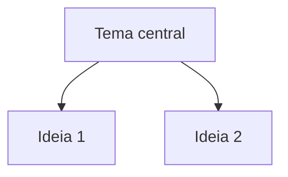

---
tags:
  - Área
  - Disciplina
---

# Título do tópico

Explicação em texto. Para ligar com outro conteúdo, use link relativo:
veja [juros compostos](../contabilidade/matematica-financeira/juros-compostos.md).

## Fórmulas

Escreva fórmulas com LaTeX: $M = C \times (1 + i)^n$

## Mapa mental

## Conceitos-chave

- Palavra-chave 1
- Palavra-chave 2

## Veja também

- [Outro tópico](../area/disciplina/topico.md)
